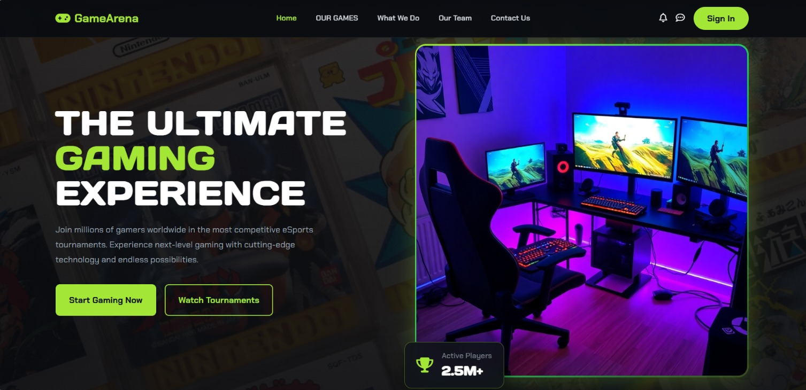
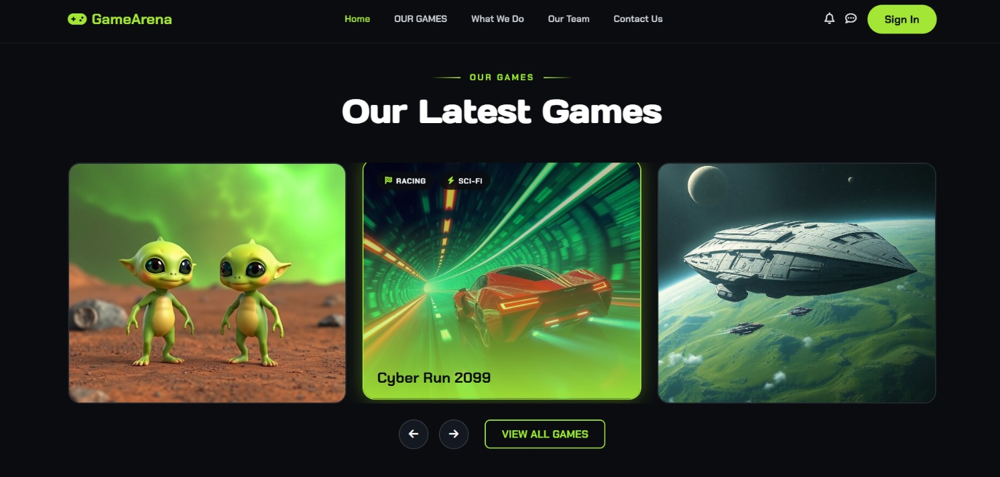
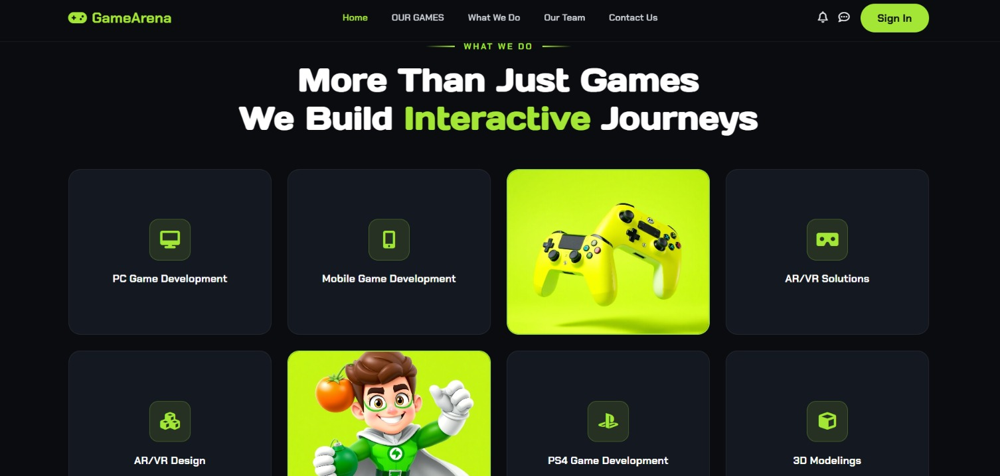
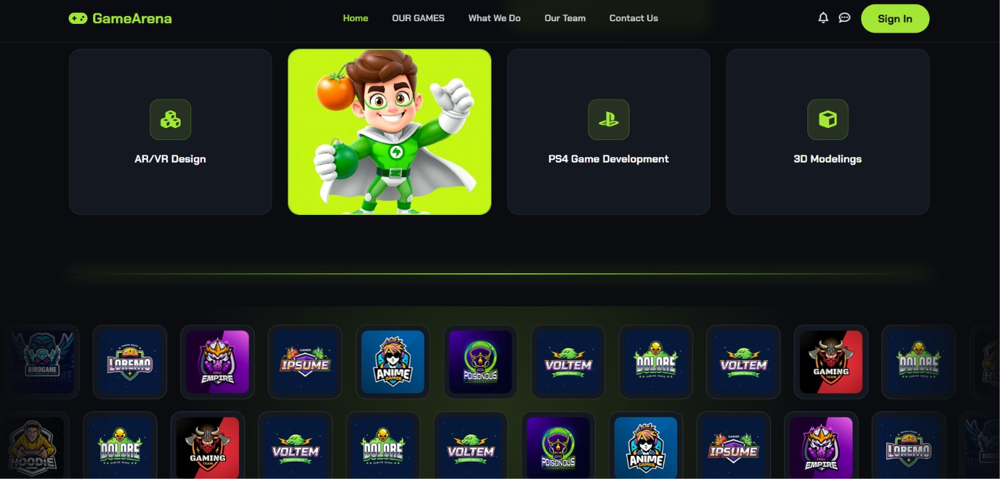
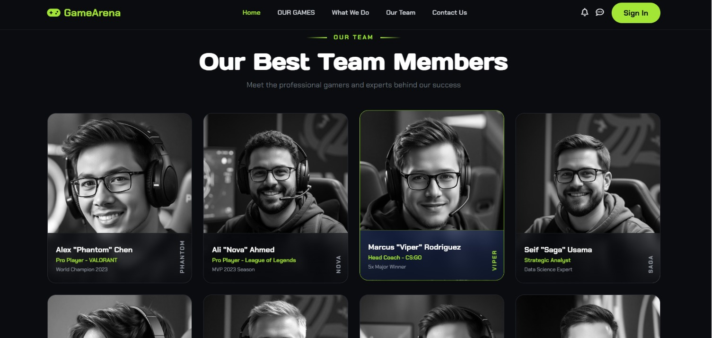

# 🎮 GameArena | Gaming & Esports Website

A modern, responsive gaming and esports website built with HTML5, CSS3, and Bootstrap 5.

GameArena features a bold dark-themed interface, vibrant neon-green accents, gaming showcases, team profiles, and a visually engaging user experience.

## 🌐 Live Demo

**[View Live Website](https://sandy-mohamed.github.io/GameArena-Gaming-Website/)**

## 📸 Screenshots

### Hero

### Our Latest Games

### What We Do

### Partner Logos

### Our Team

## ✨ Features

- 🎮 Modern gaming and esports-inspired interface
- 🕹️ Showcase of 9 featured games
- 🎠 Interactive Bootstrap game carousel
- 🏆 Game development services section
- 👥 Team member profiles
- 📱 Responsive layout for different screen sizes
- 🎨 Dark theme with neon-green accents
- 🧭 Responsive navigation menu
- 📩 Contact section with a message form
- 🌐 Social media links and community section
- ✨ Custom typography and visual styling

## 🛠️ Technologies Used

- **HTML5**
